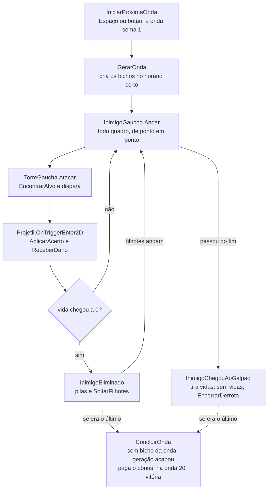

# Game Gaúcho: roteiro do pitch e guia do código

Versão do jogo: 1.2 · atualizado em 24/11/2026

## Roteiro do pitch

São cinco blocos em 10 minutos: Leonardo abre e joga, Guilherme explica o jogo por dentro e Pedro mostra a computação gráfica. A divisão segue o histórico de commits, então cada um fala do que fez. Mesmo assim, os três estudam o guia inteiro, porque o professor pode perguntar qualquer parte a qualquer um.

| Tempo | Quem | Bloco | Na tela |
| :-- | :-- | :-- | :-- |
| 0:00 a 0:45 | Leonardo | Abertura: o que é o jogo | Menu do jogo |
| 0:45 a 4:00 | Leonardo | Demonstração ao vivo | Partida no Fácil, em x2 |
| 4:00 a 6:30 | Guilherme | Como o jogo funciona por dentro | Editor com `JogoGaucho.cs` e `OndasGaucho.cs` |
| 6:30 a 9:00 | Pedro | Computação gráfica no jogo | Jogo rodando e `SpritesGaucho.cs` |
| 9:00 a 10:00 | Guilherme e Pedro | Desafios, próximos passos e fechamento | README no GitHub |

**Abertura (Leonardo)**

- "O Game Gaúcho é um tower defense 2D em pixel art, feito em Unity 6: gaúchos defendem o galpão contra bichos do Rio Grande do Sul."
- "As regras vêm do Bloons TD 6: três caminhos de melhoria, bichos que escalam, furtivos, blindados e bichos grandes que soltam outros quando caem."
- "São 26 gaúchos em quatro classes, 24 bichos, 20 ondas, três níveis, quatro modos de jogo, ranking e jogo livre depois da vitória. Não há habilidades ativáveis: tudo é passivo ou automático."

**Demonstração (Leonardo)**

- Seguir o passo a passo da seção seguinte. Enquanto as ondas rodam, apontar o que aparece na tela: o anel de alcance, o painel de melhorias e o aviso de bicho novo.

**Por dentro (Guilherme)**

- "Quando a cena do mapa abre, o código cria o objeto JogoGaucho, que controla ondas, pilas, vidas e tempo."
- "Cada onda é uma lista fixa de grupos de bichos. O bicho anda de ponto em ponto do caminho e, se chegar ao galpão, tira vidas. Dá para chamar a próxima onda antes da hora: as ondas se sobrepõem e cada bicho guarda o número da sua."
- "O gaúcho escolhe o alvo dentro do alcance pela prioridade e dispara um projétil com colisor. O bicho que morre rende pilas e pode soltar filhotes no mesmo ponto."
- "As melhorias são dados: cada nível é uma função que muda atributos, e o gaúcho recalcula tudo a partir da base a cada compra."
- "O nível muda vida e velocidade dos bichos, pilas, vidas e tempo da missão. No fim, a pontuação vai para o ranking, salvo em JSON no PlayerPrefs."

**Computação gráfica (Pedro)**

- "Usamos o template Universal 2D do Unity 6, com câmera ortográfica, que não tem perspectiva."
- "Quase toda a arte nova é gerada em código: um desenho feito de caracteres vira pixels numa Texture2D, com filtro Point para não borrar e 16 pixels por unidade."
- "A ordem de desenho vem do sortingOrder: chão e flores embaixo, depois lagoa, construções, bichos, gaúchos, arma e o avião por cima de tudo."
- "Os bichos são transladados pelo caminho, a arma gira para o alvo com Atan2 e a escala muda o tamanho de cada bicho. O gaúcho também muda de visual com cada melhoria, como as duas garruchas do Revólver."
- "Cor e transparência mostram estado: o furtivo fica com alfa 0,42, e congelado, queimando ou lento ganham tons próprios."
- "A cena usa as luzes 2D do URP, e um shader escrito por nós desenha o contorno do gaúcho selecionado e faz o bicho piscar branco quando apanha."

**Fechamento (Guilherme e Pedro)**

- "O maior desafio foi equilibrar 26 gaúchos e 24 bichos para que as 20 ondas fiquem difíceis, mas possíveis."
- "Próximos passos: mapas novos com regras próprias, como o Banhado do Taim e a Serra Gaúcha."
- "O README tem o link do executável e do vídeo. Obrigado, ficamos à disposição para perguntas."

## Demonstração ao vivo

A demonstração joga as seis primeiras ondas no Fácil, em x2, e cabe em cerca de 3 minutos. Dá tempo de contratar, melhorar, mostrar a regra dos caminhos, vender e ver o primeiro bicho furtivo, que chega na onda 6. Durante uma onda, Espaço chama a próxima antes da hora, o que faz a onda 6 chegar mais rápido. Os bichos grandes ficam para o vídeo.

1. **Menu.** Clicar em NIVEL até aparecer Fácil (40 vidas, 420 pilas e 18 minutos) e depois em JOGAR. Comentar que o menu também tem RANKING e COMO JOGAR.
2. **Tela do jogo.** Fechar a caixa de ajuda com Esc e apontar a barra de cima: vidas, pilas, onda, tempo, nível e o botão x1/x2.
3. **Contratar.** Tecla 1 escolhe o Peão da Peixeira ($70). Passar o mouse sobre o caminho e a lagoa: a prévia fica vermelha e aparece POSIÇÃO BLOQUEADA. Na grama ela fica verde, com o anel de alcance. Clicar dentro da primeira curva, ao lado da lagoa, onde o alcance cobre dois trechos do caminho.
4. **Mais dois.** Tecla 7 para o Gaúcho do Revólver ($90) e tecla 4 para o Assador do Churrasco ($100), perto das curvas. Sobram $160.
5. **Primeira onda.** Espaço inicia a onda 1. Clicar em x1 para passar a x2 (o botão vai até x3).
6. **Melhorias.** Clicar no Peão da Peixeira para abrir o painel com os três caminhos e o custo de cada nível. Z e X compram o nível 1 de dois caminhos ($35 cada) e o rótulo sobre o boneco vira 1-1-0. O terceiro caminho passa a mostrar BLOQUEADO, porque só dois caminhos podem ser usados. P troca a prioridade de alvo.
7. **Bicho novo.** Nas ondas 3 e 5 aparece o aviso NOVO BICHO com a Perdiz e a Lebre. Cada onda vencida paga um bônus de 60 + 12 × número da onda. Para ganhar tempo, apertar Espaço durante as ondas 3 e 4: a seguinte vem antes da hora e as duas correm juntas.
8. **Furtivo.** Antes da onda 6, Tab duas vezes até LENDAS e tecla 3 para o Dançador da Chula ($150), que vê furtivo. Na onda 6 chegam 4 Graxains meio transparentes, e só o Dançador mira neles.
9. **Venda.** Selecionar um gaúcho e apertar V: voltam 70% do que foi gasto, e o valor sobe na tela.
10. **Passar a palavra.** Apertar Esc para pausar e passar para o Guilherme. O Pedro despausa quando for mostrar a luz e o contorno de seleção.

**Plano B**

- O executável não abre: abrir o projeto no Unity e dar Play na cena `Menu`.
- O notebook ou o projetor falham: passar o vídeo de demonstração, com uma cópia no notebook e outra num pendrive.
- No ensaio a demonstração passou de 4:00: parar depois da onda 4 e mostrar o furtivo no vídeo.

## Guia do código

Um único objeto, o `JogoGaucho`, comanda a partida: ele é criado por código quando a cena do mapa abre e guarda pilas, vidas, ondas e as listas de bichos e gaúchos. Cada bicho, gaúcho e projétil é um componente com o próprio `Update`, e todos conversam com o `JogoGaucho`. A classe dele está dividida em três arquivos com `partial`: fluxo (`JogoGaucho.cs`), combate (`JogoGauchoCombate.cs`) e interface (`JogoGauchoInterface.cs`).

### Como o jogo começa

1. O executável abre a cena `Menu`. O `MenuGaucho` desenha os botões com `OnGUI`, e o nível escolhido fica salvo no PlayerPrefs (`Dificuldade.cs`).
2. JOGAR chama `SceneManager.LoadScene` para a cena `Teste_PixelArt`, que só tem o mapa, o caminho, o galpão e os modelos de javali e de gaúcho.
3. O `JogoGauchoBootstrap`, no fim de `JogoGaucho.cs`, roda sozinho por causa do `[RuntimeInitializeOnLoadMethod]` e se inscreve em `SceneManager.sceneLoaded`. Se a cena tem o objeto "Caminho (pontos)" e ainda não há um `JogoGaucho`, ele cria um objeto gerenciador com esse componente.
4. `JogoGaucho.Awake` lê vidas, pilas e tempo da dificuldade, ordena os pontos do caminho pelo número do nome, guarda os modelos da cena e os esconde, marca as construções como obstáculos, cria a lagoa e as luzes 2D e liga o `AmbienteGaucho`.
5. Daí em diante, o `Update` roda a cada quadro: teclas, seleção e construção (fora da pausa), destaque do selecionado, anel de alcance, efeitos, zonas, armadilhas, pacotes, tremor da câmera e luzes. Ele confere quais ondas acabaram, cuida do início automático, desconta o relógio da missão e, a cada 0,5 s, recalcula as auras de apoio.

### Mapa dos scripts

| Script | O que faz | Para saber explicar |
| :-- | :-- | :-- |
| `MenuGaucho.cs` | Menu principal: jogar, nível, modo, ranking, como jogar, opções e sair | `Botao` e a troca de cena com `SceneManager.LoadScene` |
| `Dificuldade.cs` | Fácil, Normal e Difícil: vida e velocidade dos bichos, pilas, vidas, tempo e pontos | escolha salva com `PlayerPrefs.SetInt` |
| `ModoDeJogo.cs` | Modos Padrão, Só Peões, Metade das Pilas e Desafio | `Atual`, `Alternar` e as regras que o `JogoGaucho` consulta |
| `Ranking.cs` | Top 10 das partidas, com nível e modo | lista salva em JSON, com `JsonUtility`, no PlayerPrefs |
| `MusicaDeFundo.cs` | Trilha em loop entre o menu e a fase | `DontDestroyOnLoad` mantém o objeto na troca de cena |
| `OpcoesGaucho.cs` | Volume geral, volume da música e tela cheia, no menu e na pausa | `AudioListener.volume`, `Screen.fullScreen` e PlayerPrefs |
| `JogoGaucho.cs` | Fluxo da partida | `Awake`, `Update`, `IniciarProximaOnda`, `GerarOnda`, `ConferirOndas`, `CriarInimigo`, `InimigoEliminado`, `ConcluirOnda`, `AlternarPausa`, `FaseDoChefe` e `PosicaoDeTorreValida` |
| `JogoGauchoCombate.cs` | Mira, dano, imunidades, explosões, especiais, auras, luzes, tremor e efeitos | `EncontrarAlvo`, `Nota`, `PodeFerir`, `AplicarAcerto`, `Explodir`, `AplicarAuras`, `PrepararLuzes` e `TremerCamera` |
| `JogoGauchoInterface.cs` | HUD, loja, painel de melhorias, pausa, tela final, teclas e anel de alcance | `AtualizarAtalhos`, `AtualizarConstrucao`, `DesenharPausa`, `DesenharCirculo` e `OnGUI` |
| `TempoMissao.cs` | Relógio da missão | quando zera, `AtualizarTempo` encerra a partida com derrota |
| `GalpaoGaucho.cs` | Área de chegada do galpão | trigger com corpo Dynamic travado, porque dois corpos Kinematic não geram contato |
| `TipoTorre.cs` | Tipos de dano, modos de ataque, atributos, melhorias e a lista dos 26 gaúchos | `AtributosTorre`, `Melhoria`, `DefinicaoTorre` e `TiposTorre` |
| `TorresPeoes.cs`, `TorresFarrapos.cs`, `TorresLendas.cs`, `TorresEstancia.cs` | Os 26 gaúchos: preço, ataque básico e os 3 caminhos de 5 níveis | cada nível é um `M(nome, descricao, a => ...)` |
| `MelhoriasTorre.cs` | Custo dos níveis, regra dos caminhos e venda | `Custo`, `PodeMelhorar` e `ValorDeVenda` |
| `TorreGaucha.cs` | Comportamento e visual de um gaúcho | `PrepararVisual`, `Recalcular`, `AtualizarVisualDeNivel`, `Atacar`, `MirarEm`, `EfeitoDeDisparo`, `Destacar` e `CriarSom` |
| `TipoInimigo.cs` | Os 24 bichos: vida, velocidade, recompensa, peso, imunidades, filhotes e fases do chefe | `DefinicaoInimigo` e `ImuneA` |
| `OndasGaucho.cs` | As 20 ondas e as do jogo livre | `G(bicho, quantidade, espacamento, inicio, modificadores)` e `OndaLivre` |
| `InimigoGaucho.cs` | Comportamento de um bicho | `Andar`, `ReceberDano`, `ConferirFaseDoChefe`, `AtualizarCor`, `Animar`, `Parar` e `Queimar` |
| `Projetil.cs` | Projétil reto, bumerangue, rolando pelo caminho ou caindo num ponto | `OnTriggerEnter2D`, `Girar` e `Fim` |
| `SpritesGaucho.cs` | Pixel art gerada em código e os materiais do shader | `Criar`, `Pegar`, `Quadros`, `Gaucho`, `MaterialContorno` e `MaterialBranco` |
| `Assets/Resources/SpriteEfeito.shader` | Shader de contorno e de piscar branco | fragment shader com `_MainTex_TexelSize` e `lerp` para o branco |
| `LagoaGaucho.cs` | A lagoa: desenho e regra de quem fica na água | `Contem`, o teste da elipse |
| `AmbienteGaucho.cs` | Fumaça e brasas do assado, nuvens, quero-queros e ovelhas | `ParticleSystem` criado por código |
| `EfeitosSonoros.cs` | Sons de acerto, morte, galpão, vitória e derrota | ondas sintetizadas com `AudioClip.Create` |
| `SeguirCaminho.cs`, `MirarNoAlvo.cs` | Scripts do primeiro protótipo, ainda presos aos modelos da cena | o `JogoGaucho` desliga os dois e só reaproveita os quadros do javali |

### O caminho de uma onda

Cada onda termina quando o último bicho dela sai do campo, derrubado ou no galpão.

O laço do meio roda para cada bicho a cada quadro. Os filhotes entram nele de novo, e cada onda só fecha quando não sobra nenhum bicho dela e a geração dela terminou, por isso duas ondas podem correr juntas.

## Mecânicas no código

Cada regra do Bloons TD 6 virou um dado ou um método curto. Abaixo está o que cada uma faz e onde fica, para abrir o arquivo certo se o professor pedir.

### Melhorias em três caminhos

- Cada gaúcho é uma `DefinicaoTorre` com `preco`, uma função `basico` (os atributos do nível 0) e `caminhos[3][5]`. Cada nível é uma `Melhoria` com nome, descrição e uma lambda que altera os atributos, como `a => a.veFurtivo = true`.
- Ao comprar, `TorreGaucha.Melhorar` soma 1 em `niveis[caminho]` e chama `Recalcular`, que recria os atributos do zero com `CriarBasico()` e aplica todas as melhorias compradas. Assim o resultado não depende da ordem das compras.
- Custo (`MelhoriasTorre.Custo`): preço × 0,5; 0,8; 1,5; 4 e 10, arredondado de 5 em 5. A Peixeira de $70 cobra 35, 55, 105, 280 e 700.
- Regra (`PodeMelhorar`): simula o nível novo e aceita se no máximo 2 caminhos passam de 0 e no máximo 1 passa de 2.
- Venda (`ValorDeVenda`): 70% de `Gasto`, que soma o preço e as melhorias.
- No combate vale o `Efetivo`: os atributos mais as auras dos apoios no alcance (o maior valor de cada campo, não a soma), o fortalecimento temporário e o bônus de vigia perto do galpão. Ele é refeito a cada 0,25 s.

### Mira e prioridade

- `EncontrarAlvo` percorre os bichos ativos e descarta quem está fora do alcance, quem é furtivo para aquela torre e quem é imune. Fica com a maior `Nota`.
- A distância é comparada ao quadrado (`sqrMagnitude` contra alcance²), o que evita calcular raiz quadrada para cada bicho a cada quadro.
- `Nota`: Primeiro usa `ProgressoCaminho` (número do trecho mais a fração andada, então 3,5 é o meio do quarto trecho); Último usa o negativo disso; Mais perto, menos a distância ao quadrado; Mais forte, peso × 100000 + vida, o que põe qualquer bicho grande à frente de um pequeno.
- Quem ataca vários alvos usa `EncontrarAlvos`, que guarda os N melhores numa lista ordenada por inserção.
- `Agendar` marca o próximo disparo para dali a `intervalo` segundos, ou 0,08 s entre os tiros de uma rajada.

### Dano, blindagem, imunidade e furtivo

- `PodeFerir`: com `ignoraImunidades` o ataque fere tudo; blindado (Tatu e Jacaré) não sente Corte nem Bala sem `furaBlindagem`; e cada bicho tem a sua lista de `imunidades`.
- `Enxerga`: o bicho não é furtivo ou o ataque tem `veFurtivo`. A explosão (`AfetarArea`) não passa por `Enxerga`, por isso pega furtivos dentro do raio.
- O gaúcho não mira em quem não pode ferir. Se o projétil passa por um imune, `OnTriggerEnter2D` mostra IMUNE e o projétil segue.

### Força, lentidão e estados

- Em `AplicarAcerto`, `controla = alvo.Peso <= a.forca`. Congelar, atordoar e empurrar só funcionam quando controla. A lentidão pega todos, mas vale metade nos grandes e nunca passa de 90% (`VelocidadeAtual`).
- `Parar` guarda até quando o bicho fica parado, com metade do tempo nos grandes. O Rei Javaporco tem `imuneLentidao` e ignora tudo isso.
- Queimadura: a cada 0,5 s aplica metade do dano por segundo e guarda a fração que sobra em `queimaResto`.
- Teimoso: depois de 2 s sem apanhar, recupera 1 de vida por segundo.

### Filhotes

- Quando um bicho morre, `InimigoEliminado` chama `SoltarFilhotes`. Os filhotes nascem na posição do pai e recebem `pai.ProximoPonto`, então continuam do mesmo trecho. Cada um recua 0,16 × ordem para não nascerem empilhados.
- Herdam furtivo (menos os grandes) e teimoso, mas não a casca-grossa nem as imunidades.
- `AfetarArea` copia os bichos atingidos para uma lista antes de aplicar o dano. Uma morte cria filhotes dentro de `inimigosAtivos`, e mudar um HashSet enquanto ele é percorrido dá erro.

### Ondas, pilas e dificuldade

- `GerarOnda` é uma corrotina: transforma os grupos da onda numa lista de eventos com horário (`inicio + i × espacamento`), ordena e espera com `WaitForSeconds`. Essa espera usa o tempo escalado, então o x2 (`Time.timeScale = 2`) também acelera a chegada dos bichos.
- Cada onda acaba quando a geração dela terminou e não sobra nenhum bicho dela (veja as ondas sobrepostas, abaixo). Aí `ConcluirOnda` paga 60 + 12 × onda e as rendas da Charqueada.
- Cada bicho derrubado rende a recompensa × (1 + bônus global + bônus da área).
- Pontuação: 10 por bicho e 100 por onda; na vitória, mais 500, 20 por vida e 2 por segundo que sobrou; tudo vezes o multiplicador do nível e o do modo.

| Nível | Vida dos bichos | Velocidade | Pilas | Vidas | Tempo | Pontos |
| :-- | :-- | :-- | :-- | :-- | :-- | :-- |
| Fácil | × 0,75 | × 0,9 | 420 | 40 | 18 min | × 1 |
| Normal | × 1 | × 1 | 360 | 30 | 15 min | × 1,5 |
| Difícil | × 1,35 | × 1,15 | 300 | 20 | 13 min | × 2 |

### Pausa, velocidade e ondas sobrepostas

- `AlternarPausa` põe `Time.timeScale = 0`. Com isso `Time.deltaTime` vira zero e `Time.time` para: bichos, projéteis, `WaitForSeconds`, relógio da missão e física ficam parados. Os avisos usam `Time.unscaledTime` e continuam aparecendo.
- Na pausa, o `Update` não processa clique no mapa nem construção, e a interface desenha a loja e o painel desabilitados (`GUI.enabled = false`).
- A velocidade alterna entre x1, x2 e x3 em `AlternarVelocidade`; ao despausar, o jogo volta para a velocidade escolhida.
- Cada onda iniciada vira uma `OndaAtiva` com a sua própria corrotina. Cada bicho guarda o número da onda em `Onda`, e os filhotes herdam o do pai.
- `ConferirOndas` fecha uma onda quando a geração dela terminou e nenhum bicho dela está vivo (`TemBichoDaOnda`). A vitória só vem quando a onda 20 já começou e nenhuma onda está ativa.
- Início automático (tecla A): quando o campo fica limpo, `ConferirInicioAutomatico` chama a próxima onda depois de 2 s. A escolha fica salva no PlayerPrefs.

### Modos de jogo e jogo livre

| Modo | O que muda | Pontos |
| :-- | :-- | :-- |
| Padrão | nada | × 1 |
| Só Peões | a loja só mostra a classe Peões (`ClassesDisponiveis`) | × 1,2 |
| Metade das Pilas | bichos, bônus e rendas passam por `AjustarRenda`, que paga a metade | × 1,3 |
| Desafio | `Vender` recusa e a partida começa com 1 vida | × 1,5 |

- Toda pila que entra passa por `GanharPilas`, que também soma o total da partida para a tela final.
- Depois da vitória, L (ou o botão JOGO LIVRE) chama `ContinuarJogoLivre`: o jogo volta a rodar e `OndasGaucho.Onda` gera as ondas acima da 20 por fórmula, com 15% a mais de vida por onda extra. O ranking guarda só a campanha.

### Chefe com fases

- O Rei Javaporco tem `fasesDeChefe`. Em `ReceberDano`, ao passar de 66% e depois de 33% da vida, ele chama `FaseDoChefe`: fica blindado por 2,5 s (ignora todo dano e brilha dourado), solta dois javalis e a câmera treme.

## Computação gráfica no projeto

O jogo é 2D, mas passa pelos conceitos da disciplina: coordenadas, transformações, texturas geradas por código, ordem de desenho, cor com transparência e animação. A tabela diz onde está cada um, e os itens abaixo dela explicam os que mais rendem pergunta.

| Conceito | Onde está | Como aparece no jogo |
| :-- | :-- | :-- |
| Câmera ortográfica | cena `Teste_PixelArt`, tamanho 5,625 | sem perspectiva: tudo no mesmo plano, 11,25 unidades de altura visível |
| Textura gerada por código | `SpritesGaucho.Criar`, `LagoaGaucho`, `AmbienteGaucho` | `new Texture2D`, `SetPixel`, `Apply` e `Sprite.Create` com 16 pixels por unidade |
| Filtro de textura | `FilterMode.Point` | pixel art nítida, sem a média dos vizinhos do filtro bilinear |
| Ordem de desenho | `sortingOrder` de cada `SpriteRenderer` | 0 chão; 1 flores e tufos; 2 terra do caminho e lagoa; 3 cercas, arbustos e sombras; 4 árvores, galpão e aura; 5 bichos; 6 gaúchos e coroa; 7 armas; 24 anel de alcance; 25 avião; 27 pandorga |
| Translação | `InimigoGaucho.Andar`, `Vector3.MoveTowards` | bichos andando pelo caminho, projéteis voando e recuo da arma no tiro |
| Rotação | `TorreGaucha.MirarEm`, `Projetil.Girar`, `TorreGaucha.Mover` | arma mirando, faca girando, avião acompanhando a curva |
| Escala e espelhamento | `localScale`, `flipX`, `flipY` | tamanho de cada bicho, bicho virado para onde anda, arma que não fica de cabeça para baixo, gaúcho 10% maior no nível 5 |
| Conversão de coordenadas | `ScreenToWorldPoint`, `WorldToScreenPoint`, `WorldToViewportPoint`, `InverseTransformPoint`, `InverseTransformVector` | clique no mapa, barras de vida, bordas da tela, mordida do cusco, recuo da arma |
| Cor e transparência | `SpriteRenderer.color` | furtivo com alfa 0,42, prévia verde ou vermelha, tons de congelado, atordoado, queimando, lento e blindado |
| Iluminação 2D | `Light2D` do URP em `PrepararLuzes` e `CriarLuzTemporaria` | luz global mais fraca, assado e galpão acesos, clarão nas explosões, nos tiros e nos projéteis de fogo e mágica |
| Shader | `Assets/Resources/SpriteEfeito.shader` | contorno branco no gaúcho selecionado, dourado no nível 5 e piscar branco quando o bicho apanha |
| Sombras | um filho com o sprite de círculo em cada bicho e gaúcho | elipse preta semitransparente embaixo de cada um |
| Tremor de câmera | `TremerCamera` e `AtualizarTremor` | explosões grandes, chegada de chefe e fase do chefe |
| Animação | `InimigoGaucho.Animar`, `TorreGaucha.AnimarExtras` | troca de sprite a cada 0,15 s (0,12 s no cavalo); pandorga e aura com seno |
| Curvas paramétricas | `DesenharCirculo`, `TorreGaucha.Mover` | anel de alcance com 48 pontos e avião em círculo |
| Partículas | `CriarEstouro`, `AmbienteGaucho` | estouro quando o bicho cai, fumaça e brasas do assado, brilho do nível 5 |
| Física 2D | `Projetil`, `InimigoGaucho`, `GalpaoGaucho` | colisores em modo trigger e `OnTriggerEnter2D` |
| Interface imediata | `OnGUI` | HUD, loja, painel, pausa e barras de vida redesenhados a cada quadro |

### Pixel art gerada por código

- Cada desenho é um vetor de strings, uma string por linha de pixels, e cada caractere é uma cor da paleta (`Cor(char)`). No gaúcho, '7' é o poncho, '8' é a calça (o poncho com metade do brilho) e '3' é o lenço, então um único desenho gera um gaúcho de cada cor.
- `Criar` monta uma `Texture2D` do tamanho do desenho mais 1 pixel de borda transparente (para o contorno do shader caber), pinta pixel a pixel com `SetPixel`, envia para a GPU com `Apply` e cria o `Sprite` com 16 pixels por unidade.
- O laço lê `desenho[altura - 1 - y]` porque na textura o y = 0 é a linha de baixo, e o desenho foi escrito de cima para baixo.
- Os sprites ficam guardados num `Dictionary`, então cada desenho é gerado uma vez só.
- As armas têm pivô em (0,15; 0,5), perto do cabo, para girarem em torno da mão e não do meio.

### Câmera e pixel perfeito

- O tamanho ortográfico é metade da altura visível: 5,625 mostra 11,25 unidades. Quem fixa esse valor é o componente Pixel Perfect Camera do URP, com resolução de referência de 320 × 180 e 16 pixels por unidade. Com 16 pixels por unidade, são 180 pixels de arte na vertical; numa tela de 1080 linhas, cada pixel da arte vira um bloco de 6 × 6.
- A largura visível é tamanho × 2 × aspecto, como o `AmbienteGaucho` calcula: 20 unidades em 16:9.
- `FilterMode.Point` pega a cor do texel mais próximo. O filtro bilinear faria a média dos vizinhos e borraria as bordas.

### Coordenadas

- Mouse: `ScreenToWorldPoint` converte pixels da tela em unidades do mundo, usando a distância da câmera como z. Na construção, a posição ainda é arredondada para uma grade de 0,5.
- Barras de vida e textos: `WorldToScreenPoint` faz o caminho inverso, e o y é invertido (`Screen.height - tela.y`) porque o `OnGUI` conta y de cima para baixo.
- Viewport vai de 0 a 1 nos dois eixos. `PosicaoDeTorreValida` usa isso para não deixar construir colado na borda, e o projétil reto some quando sai da tela.

### Transformações

- Mirar: `MirarEm` calcula o vetor da arma até o alvo e o ângulo com `Atan2(y, x)`, converte para graus e aplica como rotação em z (`Quaternion.Euler(0, 0, angulo)`). Com o alvo à esquerda, `flipY` evita a arma de cabeça para baixo.
- A boca da arma é `arma.position + arma.right × comprimento`: o eixo x local já vem girado, então o tiro sai da ponta em qualquer ângulo.
- Andar: `Vector3.MoveTowards` avança no máximo `velocidade × Time.deltaTime` por quadro, o que deixa o movimento igual em qualquer taxa de quadros. Se o passo passa do ponto, o resto continua no trecho seguinte.
- Avião: o ângulo cresce `velocidade / raio × deltaTime` e a posição é centro + (cos, sin) × raio, o que mantém a mesma velocidade em qualquer raio. A rotação segue a tangente, também com `Atan2`.
- Escala: `localScale` dá o tamanho de cada bicho (o Tatuzinho tem 0,65 e o Rei Javaporco, 2,4), e a casca-grossa fica 8% maior.

### Sombras, impactos e visual por nível

- Sombra: cada bicho e cada gaúcho ganha um filho com o sprite de círculo, preto com alfa 0,3, achatado (escala 0,26 na vertical) e desenhado na camada 3. A do avião fica deslocada para baixo, como se ele estivesse no ar.
- Recuo: por 0,09 s a arma volta até 0,07 unidade no sentido contrário ao tiro (`-arma.right`, levado ao espaço local com `InverseTransformVector`).
- Tremor de câmera: a câmera ganha um deslocamento aleatório que cai até zero, sempre somado à posição original (`AtualizarTremor`).
- Visual por nível (`AtualizarVisualDeNivel`): cada melhoria aparece no boneco. São duas armas quando a melhoria dá duas (como o Par de Garruchas), cinturão de balas quando o tiro fica mais rápido, pena quando o alcance cresce, óculos quando passa a ver furtivo, arma maior quando o dano dobra e brilho na arma quando ganha fogo, frio ou mágica. Pelo nível, entra uma faixa no poncho com a cor do caminho no 3, chapéu dessa cor no 4 e, no 5, contorno dourado do shader, lenço dourado, brilhos e 10% a mais de tamanho. Corpos que não são gaúcho ganham uma bandeirola.

### Cor, transparência e efeitos

- `SpriteRenderer.color` multiplica a cor da textura. A casca-grossa escurece (× 0,72), o teimoso puxa para o verde, o congelado para o azul e o atordoado para o amarelo. A queimadura pulsa para o laranja com `Color.Lerp` e `PingPong`, e cada acerto faz o bicho piscar branco por 0,06 s com o shader (sem ele, o piscar é avermelhado).
- O furtivo usa alfa 0,42: o sprite é misturado com o fundo, então o bicho fica meio transparente.
- A lagoa é uma elipse: `Contem` divide a distância ao centro pelos raios e testa dx² + dy² ≤ 1. A margem encolhe ou aumenta os raios. Na hora de pintar, a mesma distância normalizada escolhe a cor do pixel: beira, água rasa ou funda.
- Anéis de alcance e de explosão são `LineRenderer` com pontos em (cos, sin) × raio. Estouros, fumaça e brasas são `ParticleSystem` criados por código.

### Luz 2D do URP

- O projeto usa o Renderer 2D do URP, e os sprites usam o material Sprite-Lit-Default, que reage às luzes 2D.
- `PrepararLuzes` ajusta a Global Light 2D que já vem na cena (intensidade 0,82 e cor levemente quente) e cria luzes pontuais no assado e no galpão.
- Explosões criam uma luz temporária que some em 0,28 s (`CriarLuzTemporaria`, no máximo 12 ao mesmo tempo). Tiros de pólvora acendem uma luz na boca da arma por 0,06 s, e projéteis de fogo e mágica levam uma luz junto (no máximo 14).
- Os efeitos (anéis, partículas, clarão e aura) usam o material Sprites/Default, que não recebe luz: não escurecem com a luz global e por isso parecem brilhar.

### Shader de contorno e piscar branco

- `Assets/Resources/SpriteEfeito.shader` é um shader de vértice e fragmento escrito à mão. Ele fica em Resources para entrar no build e é carregado com `Resources.Load`.
- Contorno: se o pixel é transparente e algum dos quatro vizinhos (a um texel de distância, usando `_MainTex_TexelSize`) é opaco, ele pinta a cor do contorno. Por isso os sprites gerados ganharam 1 pixel de borda transparente e malha `FullRect`.
- Piscar branco: `lerp(cor, branco, _Branco)`. O bicho troca para esse material por 0,06 s quando apanha e depois volta ao material normal.
- O gaúcho selecionado troca para o material de contorno (`Destacar`). O contorno branco marca a seleção e o dourado marca o nível 5. Como o shader não recebe luz, esses gaúchos também ficam mais claros.

### Som gerado por código

- `CriarSom` monta as amostras: um seno na frequência do tiro, misturado com ruído e multiplicado por um envelope (1 − t)³ que faz o som morrer rápido. `AudioClip.Create` e `SetData` transformam isso em áudio, sem arquivo.
- Os jingles de vitória e derrota somam a nota com uma onda de três vezes a frequência, o que dá um timbre mais rico. Só a trilha sonora é um arquivo, em `Assets/Resources/Musica/`.

## Perguntas que o professor pode fazer

Cada resposta cabe em uns 20 segundos e diz qual arquivo abrir, se ele pedir. Os três devem conseguir responder todas, não só as da própria parte.

### Projeto e grupo

**Por que tower defense e por que o Bloons TD 6?**

O BTD6 tem regras claras e conhecidas: três caminhos de melhoria, inimigos que escalam, camuflagem e blindagem. Trocamos balões por bichos do RS e macacos por gaúchos, e tiramos as habilidades ativáveis para caber no prazo.

**O que cada um fez?**

Pelo histórico do Git: Pedro criou o projeto com o template Universal 2D, a cena base, o tiro com colisão do revólver e da espingarda, o menu com ranking e a trilha sonora. Guilherme fez a dificuldade, o tempo da missão, o galpão, o reinício, o fim de onda e os ajustes dos javalis e do chefe, e mexeu no ambiente, nos menus e no ranking. Leonardo transformou o protótipo em tower defense e fez o motor no estilo BTD6, com os 26 gaúchos, os 24 bichos, as 20 ondas e a lagoa, e depois a versão 1.1 (pausa, ondas antecipadas, modos, jogo livre, luz 2D e shader).

**Vocês usaram IA?**

A pergunta pode aparecer. Respondam com sinceridade e mostrem que entendem cada parte do código: este guia existe para isso.

**Qual foi a maior dificuldade?**

Equilibrar 26 gaúchos e 24 bichos para que as 20 ondas sejam difíceis, mas possíveis, sem repetir código. A saída foi tratar gaúchos e bichos como dados (`DefinicaoTorre` e `DefinicaoInimigo`) e concentrar o comportamento em poucas classes.

**Por que o repositório não tem a Library nem o executável?**

O `.gitignore` deixa de fora o que o Unity gera sozinho (Library, Temp, Logs, Builds) e os arquivos de projeto da IDE. O professor pediu só código e dependências, e o executável fica na Release do GitHub.

### Unity e arquitetura

**Como o jogo começa, se a cena não tem o script?**

O `JogoGauchoBootstrap` usa `[RuntimeInitializeOnLoadMethod]`, que o Unity chama sozinho depois de carregar a primeira cena, e se inscreve em `SceneManager.sceneLoaded`. Em toda cena com "Caminho (pontos)", ele cria o `JogoGaucho`.

**Por que a classe JogoGaucho está em três arquivos?**

Ela é `partial`: o compilador junta os três arquivos numa classe só. Separamos fluxo, combate e interface para cada arquivo ter um assunto.

**Por que cada gaúcho não é um prefab?**

Todos nascem de dois modelos da cena (revólver e espingarda) e são montados por código a partir da `DefinicaoTorre`: corpo, arma, cores e atributos. Um gaúcho novo é só uma função nova num dos arquivos `Torres*.cs`.

**Como uma melhoria muda o gaúcho?**

Cada nível é uma lambda que altera os atributos. `Recalcular` parte do básico e aplica todas as melhorias compradas, e o `Efetivo` acrescenta as auras dos apoios por perto.

**O bicho e o projétil andam do mesmo jeito?**

Não. O bicho anda no `Update` com `MoveTowards` e `Time.deltaTime`, com corpo Kinematic e sem forças. O projétil anda no `FixedUpdate`, o passo da física, pela velocidade do `Rigidbody2D`.

**O que acontece no x2 e no x3?**

`Time.timeScale = 2`. Tudo que usa `Time.deltaTime`, `Time.time` e `WaitForSeconds` fica duas ou três vezes mais rápido (no x3 o timeScale vale 3), inclusive a geração da onda. Os avisos usam `Time.unscaledTime` para durar o mesmo tempo.

**Como o ranking e o nível ficam salvos?**

No PlayerPrefs, um armazenamento de chave e valor do Unity que, no Windows, fica no registro. O ranking vira JSON com `JsonUtility` e guarda o top 10.

**Como funciona a pausa?**

`AlternarPausa` põe `Time.timeScale` em 0. Tudo que depende do tempo escalado para (movimento, tiros, `WaitForSeconds` e relógio da missão), mas os avisos usam `Time.unscaledTime`. Os cliques no mapa ficam bloqueados e a loja aparece desabilitada.

**Como dá para chamar uma onda antes da outra acabar?**

Cada onda é uma `OndaAtiva` com a sua corrotina, e cada bicho guarda o número da sua onda. Uma onda só fecha quando não sobra nenhum bicho dela, então várias podem correr juntas.

### Computação gráfica

**Por que câmera ortográfica?**

O jogo é 2D visto de cima e não precisa de profundidade: na projeção ortográfica o tamanho não muda com a distância, o que combina com pixel art. Com tamanho 5,625, cada pixel da arte vira 6 × 6 pixels numa tela 1080p.

**Como a arma mira no bicho?**

Vetor da arma até o alvo, ângulo com `Atan2(y, x)` convertido em graus e rotação em z. O pivô do sprite fica no cabo, e `flipY` corrige quando o alvo está à esquerda (`TorreGaucha.MirarEm`).

**Como os sprites são desenhados?**

Strings viram pixels numa `Texture2D` com `SetPixel` e `Apply`, filtro Point e 16 pixels por unidade. O y é invertido porque a textura começa embaixo (`SpritesGaucho.Criar`).

**Quem decide o que aparece na frente?**

Tudo está no mesmo plano, então quem decide é o `sortingOrder` do `SpriteRenderer`: o valor maior é desenhado por cima.

**Como o clique vira uma posição no mapa?**

`ScreenToWorldPoint` converte o pixel do mouse em coordenadas do mundo. Depois a posição vai para uma grade de 0,5 e passa por `PosicaoDeTorreValida`.

**Como vocês sabem se o lugar é válido?**

`PosicaoDeTorreValida` mede a distância do ponto a cada trecho do caminho, projetando no segmento com produto escalar (mínimo 1,05). Também confere galpão (1,7), outros gaúchos (0,95), obstáculos, borda da tela e a elipse da lagoa.

**Como o furtivo fica transparente?**

O alfa da cor do `SpriteRenderer` vai a 0,42, e o sprite é misturado com o que está atrás.

**Como funciona a colisão?**

O bicho tem `CircleCollider2D` e corpo Kinematic; o projétil tem colisor em modo trigger e corpo Dynamic. No contato, o Unity chama `OnTriggerEnter2D`, que aplica o dano. O galpão usa corpo Dynamic travado, porque dois corpos Kinematic não geram contato.

**O que é o OnGUI?**

É a interface imediata do Unity: a cada quadro o código desenha botões e textos de novo, e `GUI.Button` já devolve se foi clicado. Usamos no HUD, na loja e no menu.

**Como funciona a luz?**

São componentes `Light2D` do URP: a luz global da cena, um pouco mais fraca, e luzes pontuais no assado, no galpão, nas explosões, nos tiros e nos projéteis de fogo e mágica. Os sprites usam o material Sprite-Lit-Default, que soma a contribuição das luzes; os efeitos usam um material que não recebe luz e por isso parecem brilhar.

**O que o shader de vocês faz?**

No fragment shader, um pixel transparente com algum vizinho opaco vira contorno (`_MainTex_TexelSize` dá o tamanho de um texel). O mesmo shader mistura a cor com branco para o bicho piscar quando apanha.

**Como o gaúcho muda com as melhorias?**

`AtualizarVisualDeNivel` compara os atributos com os do nível 0 e desenha o que mudou: duas armas, cinturão de balas, pena, óculos, arma maior e brilho de elemento. O maior nível define o resto: faixa no poncho (3), chapéu com a cor do caminho (4) e contorno dourado (5). Os acessórios são camadas de 16 × 16 pixels por cima do boneco, com o mesmo pivô, então encaixam pixel a pixel.

### Mecânicas

**Por que só um caminho passa do nível 2?**

É a regra do BTD6 que obriga a escolher: dá para ter 5 num caminho e 2 em outro, mas não 3 e 3. `PodeMelhorar` simula o nível novo e conta os caminhos.

**Como o gaúcho escolhe o alvo?**

`EncontrarAlvo` filtra por alcance, furtivo e imunidade e fica com a maior nota da prioridade. "Primeiro" é quem andou mais no caminho (`ProgressoCaminho`).

**Por que o filhote nasce no lugar do pai?**

`SoltarFilhotes` cria o filhote na posição do pai e passa o próximo ponto do caminho, então ele continua dali. Como no BTD6, derrubar um bicho grande perto do galpão é arriscado.

**Como a dificuldade funciona?**

Ela multiplica vida e velocidade dos bichos em `CriarInimigo` e define pilas, vidas e tempo no `Awake`. Os valores estão na tabela de Mecânicas no código.

**Como funcionam os modos de jogo?**

`ModoDeJogo` guarda as regras de cada modo, como a `Dificuldade` faz com os níveis. A loja consulta `ClassesDisponiveis`, as pilas passam por `AjustarRenda` e `Vender` recusa no Desafio. A pontuação ganha o multiplicador do modo.

**O que muda na fase do chefe?**

Quando o Rei Javaporco passa de 66% e depois de 33% da vida, ele fica blindado por 2,5 s, chama dois javalis e a câmera treme (`FaseDoChefe`).

## Checklist da entrega e da apresentação

A entrega no GitHub está completa: o README tem o link do executável, que fica na Release v1.2, e o do vídeo no YouTube.

### Entrega no GitHub

- [x] Criar uma Release no GitHub e anexar o `Builds/GameGaucho_Windows.zip` (35 MB), que fica fora do git.
- [x] Trocar "\[link do executavel aqui\]" no README pelo link da Release.
- [x] Publicar as Releases v1.1 e v1.2 com o zip novo (o link do README continua valendo, porque aponta para a última Release).
- [x] Gravar o vídeo demonstrativo mostrando o que a demonstração ao vivo não alcança: bichos grandes soltando filhotes, Pescador e Iara na lagoa, gaúchos no nível 5 e o Rei Javaporco.
- [x] Subir o vídeo no YouTube e trocar "\[link do video aqui\]" no README pelo link.
- [ ] Conferir que o professor (rafaelrieder) tem acesso ao repositório.
- [ ] Conferir que os três aparecem como autores: Guilherme, Pedro e Leonardo têm commits no histórico.
- [ ] Guilherme e Pedro darem `git pull` antes de qualquer mudança nova.
- [ ] Opcional: Leonardo cadastrar no GitHub o e-mail antigo, para o commit 3d42aec contar no perfil dele.
- [ ] Antes de apresentar neste notebook, limpar o ranking (menu RANKING > LIMPAR): as partidas que estão lá são dos testes automáticos.

### Antes do dia

- [ ] Jogar uma partida inteira no Normal para conhecer as ondas 15 a 20.
- [ ] Ensaiar o pitch três vezes com cronômetro, sempre com os mesmos lugares de construção.
- [ ] Cada um responder em voz alta as perguntas da seção anterior, inclusive as da parte dos outros.
- [ ] Deixar abertos no editor `JogoGaucho.cs`, `OndasGaucho.cs`, `SpritesGaucho.cs` e `TorreGaucha.cs`.

### No dia

- [ ] Testar o executável no notebook da apresentação e no projetor, com som.
- [ ] Levar o zip e o vídeo num pendrive.
- [ ] Deixar o jogo aberto no menu antes de começar a falar.
- [ ] Deixar o README do GitHub aberto numa aba para o fechamento.
